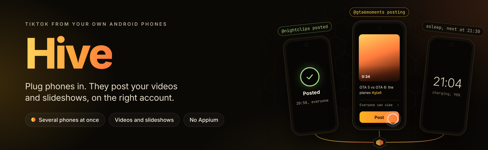
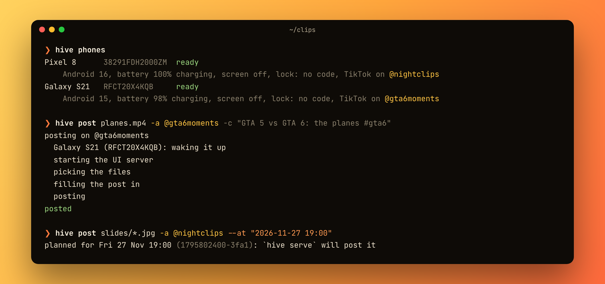

<p align="center">
  
</p>

<p align="center">
  &nbsp;
  <b>Hive</b>
  &nbsp;·&nbsp; <a href="#install">Install</a>
  &nbsp;·&nbsp; <a href="#post">Post</a>
  &nbsp;·&nbsp; <a href="#several-phones">Several phones</a>
  &nbsp;·&nbsp; <a href="#plan-posts">Plan posts</a>
  &nbsp;·&nbsp; <a href="#claude-and-other-mcp-clients">MCP</a>
  &nbsp;·&nbsp; <a href="#when-tiktok-changes">When TikTok changes</a>
</p>

Hive posts to TikTok from real Android phones plugged into your computer. Give it a
video, or pictures for a slideshow, and the account to post on: it picks the phone
that holds that account, wakes it up, opens TikTok on the account, picks the files,
types the description, chooses who can see it, taps Post, and puts the phone back to
sleep.

It drives the app the way a person would, through the screen. There is no TikTok API
key, no browser profile, and nothing to run on the phone besides TikTok and a small
UI server that Hive installs by itself. Plug in a second phone and it posts for other
accounts at the same time.

<p align="center">
  
</p>

## How it works

- **adb** lists the phones and runs everything that isn't the screen: reading the
  battery and the lock screen, waking the phone, pushing your files into its gallery,
  deleting them afterwards.
- **UiAutomator2** reads and taps the screen. Hive talks to
  [Appium's UiAutomator2 server](https://github.com/appium/appium-uiautomator2-server)
  directly over HTTP, without Appium itself: no Node.js, a session opens in about a
  second, and every phone gets its own server.
- **What TikTok calls things** (the Profile tab, the picker, the Post button) lives in
  one file, [`selectors.toml`](crates/tiktok/selectors.toml), not in the code.

Every step looks before it taps. When something isn't where it should be, Hive stops
and says what's left to do instead of guessing: it never taps Post with a problem
pending, and it never posts on an account other than the one you asked for.

## Install

You need **adb** (Android's platform-tools: `android-tools` on Arch, `adb` on
Debian and Ubuntu, `brew install android-platform-tools` on macOS) and Rust.

```sh
cargo install --git https://github.com/Rhombicdodecahedron/hive hive
```

On each phone:

1. Turn on **Developer options** (tap *Build number* seven times in *About phone*),
   then **USB debugging** in them.
2. Plug it in and allow this computer on the phone's screen.
3. Set the **screen lock** to *None* or *Swipe*. Hive never types a code, so a phone
   locked with a PIN, pattern or fingerprint waits until you unlock it.
4. Install TikTok, **in English**, and log in to your accounts. A phone can hold
   several accounts: Hive switches between them.

Check that Hive sees them:

```sh
hive phones
hive check          # opens TikTok and reads the account it's on
```

The first time, Hive installs its UI server on the phone (from an Appium install on
your computer if there is one, otherwise from the server's GitHub releases).

## Post

```sh
hive post clip.mp4 --account @yourpage --caption "What it's about #hashtags"
hive post 1.jpg 2.jpg 3.jpg --account @yourpage --title "Three things" --caption-file caption.txt
```

One video file posts a video; pictures post a slideshow, in the order you give them.

| Option | What it does |
| --- | --- |
| `--caption`, `--caption-file` | The description, #hashtags included |
| `--title` | A slideshow's title |
| `--sound "name"` | Searches TikTok's sounds and uses the first result |
| `--visibility` | `everyone` (default), `friends` or `only-you` |
| `--draft` | Fills everything in and leaves Post for you to tap |
| `--phone SERIAL` | Uses that phone only |
| `--at "2026-11-27 18:00"` | Plans it instead (see below) |

## Several phones

Plug them in. For each post Hive tries, in this order:

1. the phone you bound to the account: `hive bind @yourpage RFCT20X4KQB`;
2. the phones whose TikTok already showed that account;
3. every other ready phone, the ones known not to hold it last.

If TikTok on a phone doesn't have the account, Hive closes the account switcher,
remembers it, and moves on to the next phone. A phone that is posting is locked for
every other Hive process, so two posts never fight over one phone, and posts for
different phones run at the same time.

A phone can also stay on its charger across the room: `adb tcpip 5555` once over USB
(or Android's *Wireless debugging*), then `hive connect 192.168.1.20:5555`.

## Plan posts

```sh
hive post clip.mp4 --account @yourpage --at "2026-11-27 18:00"
hive queue                 # what's planned
hive serve                 # posts each one when its time comes
```

`hive serve` keeps running: it posts what's due, retries a post whose phone was
unplugged or locked as soon as one is back (without counting it as a failure), and
skips a post more than 6 hours late. A post that fails twice is left for you to look
at.

It also serves a dashboard at <http://127.0.0.1:7878>, with every phone's live screen,
the planned posts and what each post did, and a JSON API for your own tools:

| Endpoint | What it does |
| --- | --- |
| `GET /api/phones` | Phones, their state and the accounts seen on them |
| `POST /api/posts` | Post now: `{"account", "files", "caption", "visibility", "draft"}` → a job |
| `POST /api/queue` | Plan a post: the same, plus `"at"` |
| `GET /api/jobs/{id}` | What a post did, line by line, and its result |
| `POST /api/phones/{serial}/check` | Read the account TikTok is on |
| `GET /api/phones/{serial}/screen.png` | The phone's screen |

`hive serve` listens on 127.0.0.1 only: anyone who can reach it can post on your
accounts.

## Claude and other MCP clients

`hive mcp` serves Hive's tools over MCP, so an assistant can see your phones, post, plan
posts and follow them. It starts `hive serve` by itself when it isn't running.

```sh
claude mcp add hive -- hive mcp          # Claude Code
```

For Claude Desktop, add it to `claude_desktop_config.json`:

```json
{ "mcpServers": { "hive": { "command": "hive", "args": ["mcp"] } } }
```

| Tool | What it does |
| --- | --- |
| `hive_phones` | The phones, whether each can post, and the accounts seen on them |
| `hive_post` | Post a video or a slideshow now; returns a job |
| `hive_job` | Follow a job until it's done, line by line |
| `hive_plan`, `hive_queue`, `hive_cancel` | Plan posts, list them, remove one |
| `hive_check` | Read the account TikTok is on, on one phone |

## When TikTok changes

TikTok updates its app often, and a renamed button is what breaks first. The fix is a
file, not a release:

1. `hive screen --xml` saves every text, description and id on the phone's screen.
2. Copy the key that broke from [`selectors.toml`](crates/tiktok/selectors.toml) into
   `~/.config/hive/tiktok.toml` (only the keys you change) and fix it.
3. Please open an issue or a pull request with the fix, so everyone gets it.

`hive paths` shows where Hive keeps its config and data. `HIVE_HOME=<dir>` puts both
in one folder.

## Before you use it

Automating an account goes against TikTok's terms, and TikTok may limit or ban
accounts that post this way. Hive posts at a human pace and only what you give it,
but the risk is yours: use it on accounts you can afford to lose.

## Building

```sh
cargo build --release
cargo test
```

The workspace has one crate per part: `hive-core` (phones, accounts, posts and which
phone posts for which account), `hive-adb`, `hive-uia2` (the UI server), `hive-tiktok`
(the app's flows, tested against a pretend TikTok) and `hive` (the command line, the
queue and the dashboard).

## Contributing

Fixes for a TikTok update are the most welcome: see *Fixing a selector* in
[CONTRIBUTING.md](CONTRIBUTING.md). The rules for code, and for coding agents working on
the repository, are in [AGENTS.md](AGENTS.md). Security problems:
[SECURITY.md](SECURITY.md).

## Licence

MIT or Apache-2.0, at your option. The UiAutomator2 server Hive installs on phones is
Appium's, under Apache-2.0.
